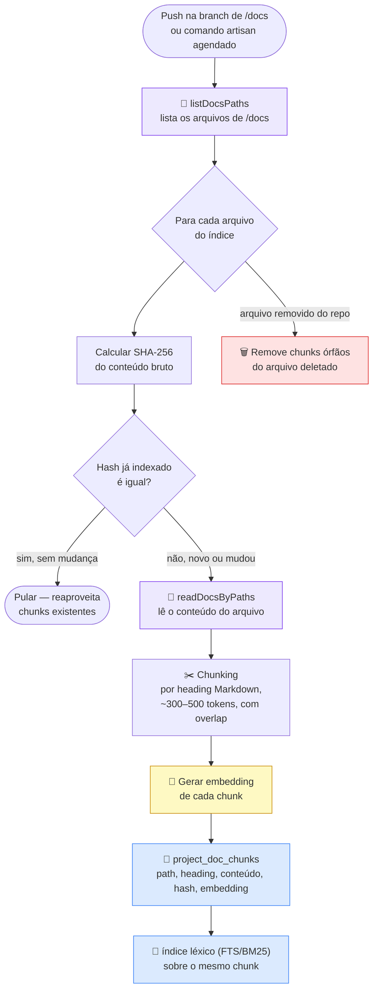
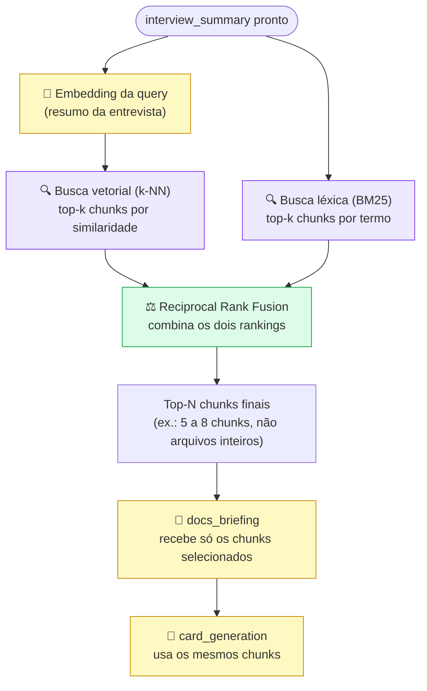
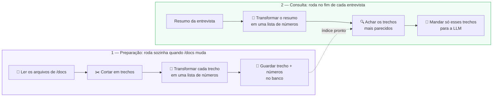
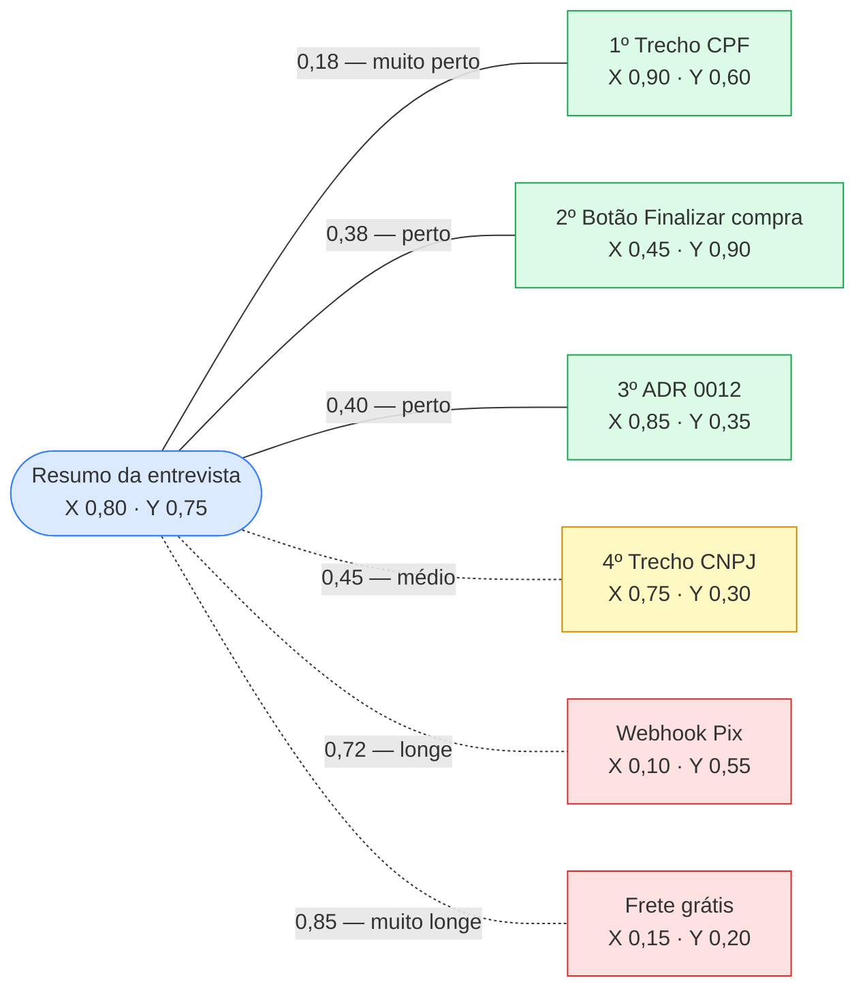
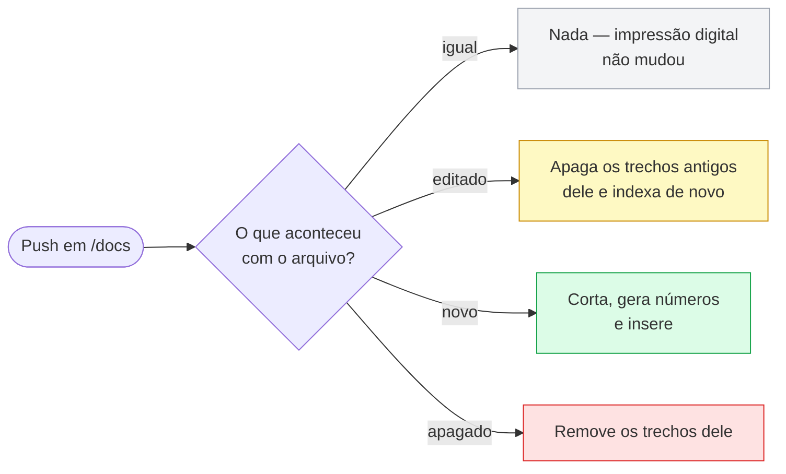
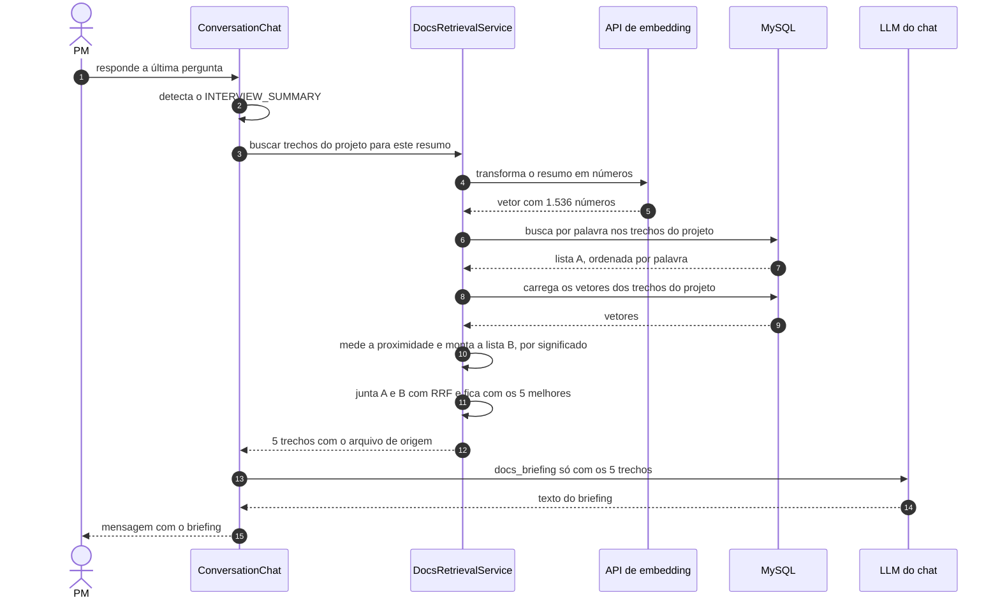
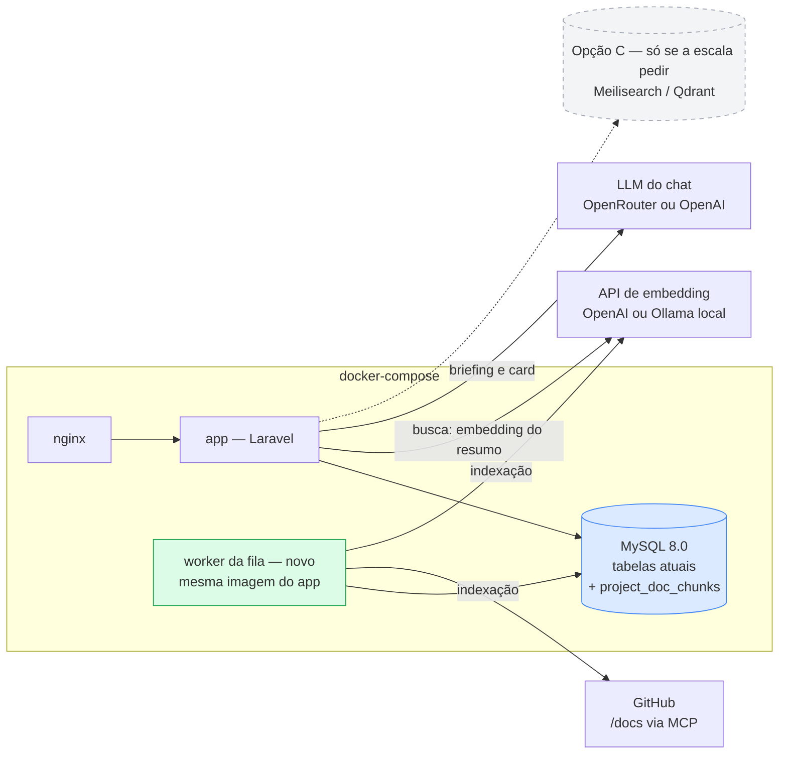

# PM Helper — Roteiro Pós-MVP

> **Base:** produto atual (0.10.0 + Discovery no card, 24/10/2026) · [`MVP_LAUNCH_GUIDE.md`](./MVP_LAUNCH_GUIDE.md)
> **Baseline anterior:** 0.10.0 (19/10/2026) · Explorar/RAG
> **Objetivo deste documento:** organizar, por trilha e prioridade, o que fica **depois** do fechamento do MVP. Índice/Explorar e Discovery no card já saíram. O foco pós-teste é a [Trilha A](#4-trilha-a--produto-e-fluxo-itens-já-listados-no-launch-guide-em-ondas) (fricção do fluxo) e ligar o índice ao **card** (Trilha B · entrevista). Plano de teste: [`E2E_MANUAL_TEST_PLAN.md`](./E2E_MANUAL_TEST_PLAN.md).

Legenda usada daqui em diante: **Concluído** · **Parcial** · **Em aberto**.

---

## Situação atual (fechamento do MVP)

A 0.9.0/0.10.0 entregaram o **Explorar** e o índice. Em seguida entrou o **Discovery por agente** no card aprovado (0010) e a regeneração com respostas às dúvidas (0011). O card da entrevista **continua** no pipeline ao vivo de `/docs` (índice não alimenta briefing/card).

### Em aberto — o que ainda dói

| Onde | Item |
|---|---|
| Trilha A | Reusar conversa vazia, exclusão lógica, reativar projeto |
| Trilha A · Onda 1 | Editar card, exportar, desmembrar épico |
| Trilha A · Onda 2 | Comentários, notificações, dashboard de cards por status |
| Trilha A · Onda 3 | Histórico de versões do card, busca em cards antigos, custo por squad (e custo do agente fora de `LlmUsage`) |
| Trilha B · entrevista | O índice **não** entra no briefing nem no card. Seguem as duas chamadas (`docs_retrieval` + `docs_briefing`), o teto em caracteres, a leitura repetida a cada entrevista e o alerta de duplicidade só com o que está em `/docs` |
| Trilha B · 1b | Nota de contexto do projeto, fonte fora do GitHub, busca no código, entrevista que aprofunda "como funciona hoje" sem doc, selo de card sem contexto verificado |
| Trilha B · memória de cards | `FULLTEXT` e embedding dos cards; mencionar um card no chat (2a e 2b) |
| Trilha B · índice | Busca por palavra, RRF, hash incremental, fila, agenda e webhook (o que o Explorar ainda não faz da escada 3a–3c). Motor dedicado (3d), grafo/drift (Fase 4) e federação (Fase 5) |

### Parcial

| Item do roteiro | O que a 0.10.0 já cobre | O que falta |
|---|---|---|
| Fase 1a — README | `README.md` entra no índice do Explorar junto com `/docs` | `ARCHITECTURE.md` e `AGENTS.md`. A entrevista não consulta o índice nem avisa que a doc é fraca |
| Fase 1a — contexto manual | Upload de `.md` na tela Documentos, sem projeto; o Explorar sem projeto busca esses arquivos | Campo na entrevista e uso desse texto no `card_generation` |
| Fase 1b · item 2 — outra fonte | O admin escolhe caminhos **dentro** do GitHub (`README.md`, `docs/`, `docs/adr/`, `docs/discovery/`, `docs/references/`, `docs/rules/`) | Notion, Confluence, Google Docs, PDF |
| 3a — trechos de `/docs` | Corte por seção, parágrafo ou tamanho, com caminho da seção gravado no trecho | `FULLTEXT`, `content_hash` e a saída do `docs_retrieval` na entrevista. O padrão do corte, até o admin trocar, continua por tamanho |
| 3b — embedding | Cosseno em PHP no Explorar, score mínimo, modelo de embedding no painel, `LlmUsage` da chamada | RRF com busca por palavra. A entrevista não mede proximidade do resumo |
| 3c — reindexar | Botão **Sincronizar** na lista de projetos: em sucesso apaga o índice daquele projeto e gera de novo, só `.md`, com o admin na tela | Fila, agenda, webhook e pular arquivo cujo conteúdo não mudou |
| Onda 2 — retomar entrevista | Reabrir a conversa devolve as mensagens e a entrevista segue | O bloco bruto de `/docs` do **Gerar Card** continua na sessão |

### Concluído (não reabrir como pendência)

| Entrega | Onde |
|---|---|
| Chat Explorar, sem gerar card, com projeto opcional | 0.9.0 |
| CRUD de `.md` e indexação de `/docs` + `README.md` no primeiro salvamento | 0.9.0 |
| Modelo do Explorar, parâmetros do índice, sync, corte, score, fontes, filtro de status | 0.9.0 → 0.10.0 |
| Discovery por agente no card aprovado (disparo, estados, anexo) | discovery 0010 |
| Responder dúvidas do Discovery e regenerar | discovery 0011 |

---

## 1. Onde estamos (baseline honesto)

O MVP cobre qualificação (entrevista → resumo → card), Explorar com índice, e Discovery por agente no card aprovado (com regeneração por dúvidas). O admin define modelo por prompt; o catálogo LLM e a auditoria admin estão no banco. A busca do Explorar ignora documento que não está vigente.

Duas trilhas seguem **depois** do e2e de fechamento:

- **Trilha A — Produto/fluxo:** correções do fluxo, editar card, mencionar card, exportar, comentários, notificações, dashboard. Quase toda **em aberto**; a retomada da conversa está **parcial**.
- **Trilha B — Contexto de projeto:** o pipeline que embasa o **card** continua o foco, porque o índice atende o Explorar e deixa a entrevista no caminho antigo.

### O que a entrevista faz com `/docs` — em aberto, igual à 0.8.0

1. `listDocsPaths` — lista só os caminhos de `/docs` via MCP GitHub.
2. `docs_retrieval@v1` — 1ª chamada LLM: escolhe até 10 arquivos relevantes a partir do resumo da entrevista.
3. `readDocsByPaths` — lê só o subset (teto `GITHUB_MCP_MAX_CHARS`, hoje 80k chars).
4. `docs_briefing@v2` — 2ª chamada LLM: gera o texto humanizado para o PM.
5. `card_generation@v3` — usa o conteúdo original de `/docs` (não o briefing, e não os trechos do índice) para gerar o card.

### O que o índice faz — concluído para o Explorar

1. No primeiro salvamento do projeto, e de novo no botão **Sincronizar**, lê os caminhos marcados no painel (padrão: `README.md` e `docs/`, inclusive subpastas), só `.md`.
2. Grava o documento, tira o frontmatter, corta em trechos e gera embedding.
3. O Explorar busca os trechos mais próximos daquele projeto (ou, sem projeto, os documentos sem projeto), acima do score mínimo, e descarta status que não seja `current`, `stable` ou vazio.
4. A resposta cita o arquivo no tooltip.

### Limitações que seguem na entrevista (ADR 0004, ADR 0005 e código)

| Limitação | Impacto | Situação |
|---|---|---|
| **2 chamadas LLM extras por entrevista** (retrieval + briefing), além da geração do card | Custo e latência no fluxo do card, mesmo quando `/docs` é pequeno | **Em aberto** na entrevista. O Explorar não faz essas duas chamadas |
| **Depende de `/docs` existir e estar bem estruturado** | Projeto sem essa pasta fica sem contexto no card | **Em aberto** na entrevista. O índice também lê o `README.md`, só para o Explorar |
| **Sem cache na entrevista** — cada fechamento relê `/docs` | Repete custo mesmo se a doc não mudou | **Em aberto**. O índice evita reler na pergunta do Explorar; a sincronização ainda reprocessa o projeto inteiro |
| **Fallback é o dump completo da árvore** | Em repositórios grandes, aborta por teto (`too_large`) | **Em aberto** na entrevista |
| **Seleção de arquivos por prompt** | A entrevista escolhe arquivo inteiro ou nada | **Em aberto** na entrevista. O Explorar já busca trecho |
| **"Alerta de demanda já coberta" depende só do que está em `/docs`** | Card parecido já gerado no PM Helper passa batido | **Em aberto** (degraus 2a e 2b) |

O lançamento segue com esse comportamento de conversa e de projeto. Reusar a conversa vazia, exclusão lógica e reativar projeto desativado estão nas [correções do fluxo](#correções-do-fluxo-atual) da Trilha A, todas **em aberto**.

---

## 2. Como priorizar

Quatro critérios, nessa ordem:

1. **Não depender de pré-requisito que o projeto do PM não tem** (ex.: `/docs` bem escrita) — resolver isso é mais urgente que otimizar quem já tem.
2. **Reduzir custo/latência do que já roda em toda entrevista** antes de adicionar infraestrutura nova.
3. **Valor percebido pelo PM no dia a dia** (editar card, exportar) compete por prioridade com a trilha de contexto — não é "docs primeiro, resto depois", são ondas paralelas.
4. **Subir a indexação um degrau por vez, só com a dor à vista.** Entregar o 2a ou o 3a não abre o seguinte. Embedding, fila e motor de busca esperam o sintoma da [escada](#escada-da-indexação): paráfrase que o `FULLTEXT` errou, índice desatualizado, ou busca lenta na entrevista.

---

## 3. Trilha B — Evolução do contexto de projeto (`/docs`)

Inspirada em conceitos do [`my-memory`](https://github.com/FelipeMiiller/my-memory) (RAG híbrido, grafo de conhecimento, MCP nativo, indexação incremental), mas dimensionada para o estágio do PM Helper — sem replicar a infraestrutura pesada do projeto original (ver Seção 3.6).

### Fase 1a — Quick wins, sem infraestrutura nova

> **Situação: parcial.** O `README.md` já entra no índice do Explorar. O restante desta fase, inclusive tudo o que baratearia a **entrevista**, está **em aberto**.

Resolve o caso "não tenho `/docs` documentado" e corta custo óbvio, sem tocar em arquitetura.

- **Parcial — Fallback quando `/docs` não existe ou vem vazio.** O que entrou: `README.md` da raiz é indexado junto com `/docs` para o Explorar (0.9.0). **Em aberto:** `ARCHITECTURE.md` e `AGENTS.md`; tratar isso como contexto fraco e avisar o PM na entrevista.
- **Parcial — Contexto manual colado pelo PM.** O que entrou: upload de `.md` na tela Documentos, sem projeto, consultável no Explorar sem projeto. **Em aberto:** campo no chat da entrevista e uso desse texto no `card_generation`.
- **Em aberto — Pular o `docs_retrieval` quando a árvore é pequena:** se `listDocsPaths` devolve poucos arquivos (ex.: ≤ 3), ler tudo direto e economizar a 1ª chamada LLM.
- **Em aberto — Cache por commit/branch:** guardar o resultado de `listDocsPaths` (e opcionalmente o conteúdo lido) por `repository@branch@commit_sha`, invalidando só quando o SHA muda. A sincronização do índice reprocessa o projeto inteiro; não olha o SHA.
- **Em aberto — Orçamento por tokens, não por caracteres:** trocar `GITHUB_MCP_MAX_CHARS` por um teto de tokens estimados, alinhado ao modelo em uso — o teto da entrevista continua arbitrário em relação ao que a LLM realmente aceita.

**Esforço:** baixo · **Depende de:** nada novo · **Resolve:** custo repetido + projetos sem `/docs`.

### Fase 1b — Cascata de contexto quando nem `/docs` nem `README` bastam

> **Situação: em aberto**, com uma entrega vizinha já no ar. O painel escolhe quais caminhos do GitHub entram no índice (discovery 0016). Isso não é fonte fora do repositório e não muda o card.

Este é o buraco que sobra depois da Fase 1a: repositório sem `/docs`, com `README` vazio, genérico ou desatualizado. Seguir sem contexto gera um card às cegas, sem sinalizar o risco. A resposta é uma escada de alternativas, da mais barata para a mais cara, aplicada nessa ordem antes de desistir:

1. **Em aberto — Nota de contexto persistente por projeto (não por conversa).** O `Project` guarda nome, repositório e branch. Falta um campo de "contexto do produto" preenchido uma vez (pelo admin ou por qualquer PM) e reaproveitado em toda entrevista daquele projeto.
2. **Em aberto — Fonte alternativa de docs fora do repositório de código.** Spec em Notion, Confluence ou Google Docs. **Concluído ao lado, e é outra coisa:** checkboxes de caminhos do próprio GitHub (`README.md`, `docs/`, `docs/adr/`, `docs/discovery/`, `docs/references/`, `docs/rules/`). PDF e link público continuam fora.
3. **Em aberto — Busca de código sob demanda, sem indexar nada.** Antes de desistir, buscar por palavras-chave do resumo da entrevista direto no repositório (code search do próprio MCP GitHub, ou `grep` via API), trazendo trechos de rotas/controllers com nomes parecidos. Embedding fica para os degraus 2b e 3b, e só se essa busca (ou o `FULLTEXT` dos degraus 2a/3a) não achar o que o PM precisa.
4. **Em aberto — Entrevista se adapta à ausência de contexto.** Quando nenhuma fonte de `/docs` está disponível — o que já se sabe antes da 1ª pergunta —, o prompt de `interview` passa a aprofundar deliberadamente a fase "Como funciona hoje". O prompt trata os dois cenários do mesmo jeito.
5. **Em aberto — Selo "gerado sem contexto de projeto verificado" no card.** Se nada acima resolver, o card sai marcado — na lista e no preview — avisando que ninguém confrontou o card com `/docs`, README, nota de projeto, fonte alternativa ou busca de código.

**Esforço:** médio (item 2 é o mais custoso; itens 1, 4 e 5 são baratos e podem entrar isolados) · **Depende de:** Fase 1a (README/ARCHITECTURE já resolve parte dos casos antes de chegar aqui) · **Resolve:** a lacuna real da pergunta "e se não tiver nada, nem `/docs` nem README suficiente?" — sem isso, o PM Helper hoje simplesmente segue sem avisar.

### Escada da indexação

> **Situação: a escada da entrevista segue em aberto. O Explorar subiu um atalho.** Há trechos e embedding de `/docs` consultados no Explorar (cosseno, sem `FULLTEXT` e sem RRF). Cards e resumos não têm índice. A entrevista relê `/docs` a cada fechamento.

Indexar, neste roteiro, é guardar trechos e consultá-los na **entrevista**, em vez de reler a fonte toda vez. A Fase 2 indexa o que o próprio PM Helper já gerou (cards e resumos). A Fase 3 indexa `/docs` para o card. As duas sobem a mesma escada. O Explorar já tem o embedding de `/docs`; isso não fecha o 3a nem o 3b, porque falta a busca por palavra, o RRF e o uso no briefing e no card.

O contrato não muda entre degraus: uma tabela de trechos por projeto, o GitHub (ou o card salvo) continua sendo a fonte da verdade, e a busca filtra por `project_id` antes de ranquear. O embedding entra como coluna nessa mesma tabela. Fila e motor externo entram depois, sem trocar o que a tabela guarda.

| Degrau | Situação | O que se implementa | Dor que justifica | Pode esperar enquanto |
|---|---|---|---|---|
| **2a** | **Em aberto** | `FULLTEXT` do MySQL em `interview_summary` e nos campos do `Card`, por projeto | O alerta de "demanda já coberta" não olha os cards já gerados | Poucos cards por projeto, e o PM ainda reconhece o histórico de cabeça |
| **2b** | **Em aberto** | Embedding desses mesmos cards, cosseno em PHP | A busca do 2a volta vazia para uma demanda que o time já pediu, dita com outras palavras | O 2a acha as duplicatas que o PM esperava achar |
| **3a** | **Parcial** no Explorar | Chunk por heading `##` + `content_hash` + `FULLTEXT` sobre `/docs`. **No ar:** corte por seção no índice do Explorar, com caminho da seção. **Em aberto:** `FULLTEXT`, hash e uso na entrevista | O retrieval da entrevista custa caro, o arquivo inteiro polui o briefing, ou o fluxo aborta por `too_large` | A árvore cabe no atalho da Fase 1a e o `docs_retrieval@v1` acerta o arquivo certo |
| **3b** | **Parcial** no Explorar | Coluna `embedding` + RRF com o ranking do 3a. **No ar:** embedding e cosseno no Explorar, score mínimo. **Em aberto:** RRF e a entrevista | O briefing ignora a seção certa quando o resumo não repete as palavras do doc | As palavras do resumo já aparecem na seção que deveria entrar |
| **3c** | **Parcial** | Fila, botão "Reindexar", agenda e webhook. **No ar:** botão Sincronizar, substituição completa, síncrona. **Em aberto:** fila, hash, agenda e webhook | O índice cita trecho velho, ou a indexação trava a tela | Um reindex manual ainda é aceitável e alguém percebe quando `/docs` mudou |
| **3d** | **Em aberto** | Meilisearch, Typesense ou Qdrant no lugar da busca em PHP | A busca é sentida na latência | O cosseno em PHP, filtrado por projeto, continua na casa de décimos de segundo |

Quem gera o embedding (OpenAI ou Ollama) e o ADR que autoriza persistir trecho de `/docs` no MySQL — hoje o [ADR 0004](adr/0004-ler-docs-via-mcp-github.md) mantém esse conteúdo só na sessão — entram junto com o **primeiro degrau que grava texto de `/docs` (3a)** ou que chama API de embedding (**2b** ou **3b**). O detalhe de custo, worker e privacidade está no [anexo](#7-anexo--indexação-explicada-do-zero).

### Fase 2 — Memória própria do PM Helper (independe do repositório ter `/docs`)

> **Situação: em aberto.** Nenhum índice em cards nem em resumos. O alerta de demanda já coberta continua só com o `/docs` lido na entrevista.

O PM Helper acumula conhecimento a partir do que ele mesmo já gerou. O alerta de "demanda já coberta" passa a considerar o histórico de cards do time, mesmo quando o repositório não tem `/docs`. Começa por busca de palavra nos dados que já estão no MySQL. Embedding é o degrau seguinte, se essa busca errar por vocabulário.

#### 2a — Busca por palavra nos cards e resumos · em aberto

- Índice `FULLTEXT` em `interview_summary` e nos campos do `Card`, sempre filtrado por projeto.
- Antes de fechar o card, buscar cards e resumos do mesmo projeto com as palavras do resumo da entrevista.
- **Mencionar um card no chat:** o PM referencia um card existente do projeto durante a entrevista; o seletor reusa essa busca. Sem o 2a, não há de onde puxar o card com contexto.
- Nenhuma API nova, nenhuma tabela de vetor, nenhum worker.

**Implementar quando:** duplicata de card escapa e `/docs` não tinha como acusá-la — o sintoma aparece depois que o projeto acumula cards.
**Pode esperar enquanto:** o volume por projeto é baixo e o PM ainda vê a repetição na lista.
**Esforço:** baixo · **Depende de:** cards já salvos naquele projeto · **Resolve:** duplicidade óbvia, por palavra igual.

#### 2b — Busca por significado nos cards · em aberto

- Mesmos registros do 2a ganham `embedding` e `embedding_model`.
- A entrevista gera o embedding do resumo e mede proximidade em PHP. O RRF junta esse ranking com o `FULLTEXT` do 2a.
- A chamada de embedding grava `LlmUsage` (step próprio, ex.: `card_indexing`) e preço em `config/llm.php`.

**Implementar quando:** o 2a não devolve o card antigo que o PM sabe que existe, porque as palavras não batem.
**Pode esperar enquanto:** o 2a cobre os casos reais de duplicata.
**Esforço:** médio · **Depende de:** 2a em uso, e a dor de paráfrase confirmada · **Resolve:** duplicata dita com outras palavras.

### Fase 3 — Indexação de `/docs` em degraus

> **Situação: parcial no Explorar, em aberto na entrevista.** O índice guarda trechos com embedding e o Explorar busca por cosseno. A entrevista ainda pede para uma LLM escolher arquivos inteiros. Faltam `FULLTEXT`, RRF, hash incremental e o uso desses trechos no briefing e no card.

Para quando `/docs` existe e o pipeline da entrevista (LLM escolhe arquivos inteiros) deixa de ser suficiente. O destino, se todas as dores aparecerem, é o `memory_search` do my-memory: pedaços de texto, busca por palavra e por significado, combinadas por RRF, reindexando só o arquivo cujo `content_hash` mudou. A implementação da entrevista começa bem antes disso. O Explorar já ocupa o miolo do 3b (embedding e cosseno), sem o 3a léxico e sem ligar o resultado ao card.

> Nunca trabalhou com indexação? O [Anexo — Indexação explicada do zero](#7-anexo--indexação-explicada-do-zero) descreve o mecanismo completo (é o degrau 3b). Chunking, hash e `FULLTEXT` já valem no 3a; embedding, RRF e worker entram nos degraus seguintes.

#### 3a — Índice de texto, sem embedding · parcial no Explorar, em aberto na entrevista

**Na 0.10.0:** o Explorar já corta por seção do Markdown (ou por parágrafo, ou por tamanho), grava o caminho da seção e busca esses trechos por significado. O alvo abaixo, para a entrevista, segue **em aberto**.

- Cortar cada arquivo de `/docs` nos títulos `##` (~300–500 tokens, overlap se a seção estourar o teto), guardando `path`, `heading`, `content` e `content_hash`.
- Índice `FULLTEXT` sobre o conteúdo. A entrevista busca pelas palavras do resumo e manda os trechos ao `docs_briefing` e ao `card_generation`.
- `docs_retrieval@v1` sai do fluxo nesse projeto: a escolha do que ler vira busca, e a chamada LLM que sobra é o briefing.
- Incremental pelo hash: arquivo igual é pulado. A primeira indexação de um SHA pode rodar na própria entrevista enquanto o volume for pequeno — chunking e `FULLTEXT` são CPU local.

**Implementar quando:** alguma destas dores aparecer de fato — custo/latência do `docs_retrieval` em toda entrevista, briefing diluído porque o arquivo inteiro entrou, ou aborto `too_large`.
**Pode esperar enquanto:** `/docs` é pequeno (o atalho da Fase 1a já lê tudo e pula o retrieval) e a seleção por arquivo acerta.
**Esforço:** médio · **Depende de:** Fase 1a (o cache por commit já diz se o SHA mudou) · **Resolve:** custo estrutural do retrieval e o teto de arquivo inteiro, para busca por palavra.

#### 3b — Embedding e busca híbrida · parcial no Explorar, em aberto na entrevista

**Na 0.10.0:** o Explorar já gera embedding, mede cosseno em PHP e descarta trecho abaixo do score mínimo. O modelo de embedding sai do painel. **Em aberto:** RRF com busca por palavra, e usar o resumo da entrevista para escolher trechos do briefing e do card. Trocar o modelo avisa que a reindexação fica pendente; não reindexa sozinha.

- A mesma tabela ganha `embedding` e `embedding_model`. Trechos antigos ficam com a coluna vazia até serem reindexados.
- No fim da entrevista: embedding do resumo, k-NN em PHP, RRF com o ranking `FULLTEXT` do 3a. O briefing recebe os mesmos 5–8 trechos, agora também quando o resumo não repete as palavras do doc.
- Trocar de modelo de embedding reindexa o projeto inteiro: vetores de modelos diferentes não se comparam.

**Implementar quando:** o 3a perde a seção que um humano acha no doc com outra palavra (o exemplo do anexo: "checar CPF" contra uma seção que só diz "validação de documento").
**Pode esperar enquanto:** as palavras do resumo já caem na seção certa.
**Esforço:** médio · **Depende de:** 3a estável e a dor de paráfrase confirmada · **Resolve:** recall quando o vocabulário do PM e o de `/docs` divergem.

#### 3c — Cadência: fila, agenda, webhook · parcial

Indexar deixa de competir com a tela do PM. Três disparos, do mais simples ao mais automático — cada um sobe só se o anterior falhar na prática:

1. **Concluído, numa forma mais simples** — botão **Sincronizar** na lista de projetos. Em sucesso apaga os documentos daquele projeto e indexa de novo, só `.md`, com o admin esperando na tela. Não compara hash.
2. **Em aberto** — comando agendado (ex.: de madrugada), que só reprocessa hash diferente.
3. **Em aberto** — webhook do GitHub a cada push na branch. A GitHub App já existe (Discovery 0002).

A fila é `QUEUE_CONNECTION=database` (tabela no MySQL que já existe) e um `php artisan queue:work` com a mesma imagem do `app`. Redis não entra.

**Implementar quando:** o índice mente (trecho antigo ou arquivo novo ausente) ou a sincronização segura a tela. O botão já existe. Fila, agenda e webhook sobem quando esse botão reprocessar projeto grande demais, ou quando ninguém lembrar de sincronizar depois de um push.
**Pode esperar enquanto:** reindexar na primeira entrevista de um SHA novo ainda é instantâneo e alguém percebe quando `/docs` mudou.
**Esforço:** médio · **Depende de:** 3a (e, na prática, 3b) · **Resolve:** índice fresco sem travar o chat.

#### 3d — Motor de busca dedicado · em aberto

Meilisearch, Typesense ou Qdrant passam a responder BM25 + vetorial + RRF. O contrato dos trechos continua o mesmo; muda só quem executa a busca. PostgreSQL + pgvector só entraria se o projeto migrasse de banco por outro motivo.

**Implementar quando:** a busca do 3b ficar perceptível na entrevista, com milhares de trechos.
**Pode esperar enquanto:** o cosseno em PHP, filtrado por `project_id`, continuar na casa de décimos de segundo — a escala esperada no anexo.
**Esforço:** alto · **Depende de:** 3b com volume real medido · **Resolve:** latência de busca, não qualidade.

#### Detalhe do mecanismo — estado do degrau 3b

O restante desta fase explica, passo a passo, como ficam a indexação e a busca quando o 3a e o 3b já subiram. No 3a o fluxo para antes de gerar embedding: chunk → grava texto e hash → `FULLTEXT`.

#### Conceitos-chave (glossário rápido)

| Termo | O que é | Por que importa aqui |
|---|---|---|
| **Chunk** | Um pedaço de um documento (ex.: uma seção `##` de até ~500 tokens), não o arquivo inteiro | Permite recuperar só o trecho relevante de um arquivo grande, em vez de mandar o arquivo todo para a LLM |
| **Embedding** | Vetor numérico (ex.: 768 ou 1536 dimensões) gerado por um modelo a partir de um texto | Textos com significado parecido ficam "próximos" no espaço vetorial — permite buscar por significado, não só por palavra exata |
| **Busca vetorial (semântica)** | Compara o embedding da pergunta com o embedding de cada chunk (similaridade de cosseno / k-NN) | Encontra "validação de documento fiscal" mesmo se a pergunta disser "checar CPF" |
| **Busca léxica (BM25 / full-text)** | Ranking clássico por frequência de termos, como um `grep` inteligente com peso | Acha nomes exatos, siglas, códigos de erro e campos que a busca vetorial às vezes "borra" |
| **RRF (Reciprocal Rank Fusion)** | Fórmula que combina duas listas de ranking em uma só, somando `1 / (k + posição)` de cada chunk em cada lista onde ele aparece | Motivo de usar os dois tipos de busca juntos: cada um cobre a fraqueza do outro |
| **Indexação incremental** | Reprocessar (gerar embedding de novo) só o que mudou, comparando hash do conteúdo | Sem isso, cada push em `/docs` custaria reindexar tudo de novo, mesmo o que não mudou |

#### Fluxo de indexação (roda fora da entrevista, uma vez por mudança em `/docs`)

> 📂 lê `/docs` via MCP · ✂️ chunking · 🧮 gera embedding · 💾 persiste



No degrau 3a o bloco amarelo (embedding) ainda não existe: o chunk vai direto para a tabela e para o `FULLTEXT`. A cadência — indexar uma vez por mudança de hash, não uma vez por entrevista — já vale no 3a e é o que elimina o retrabalho da Fase 1a. Rodar esse fluxo fora da entrevista é o degrau 3c.

#### Fluxo de busca híbrida (degrau 3b; no 3a só roda o ramo léxico)

> 🧮 gera embedding · 🔍 busca · ⚖️ combina rankings · 🤖 chama a LLM



`docs_retrieval@v1` sai no degrau 3a, quando a escolha do que ler vira `FULLTEXT`. O RRF (ramo vetorial + léxico) é o acréscimo do 3b. O corte de custo estrutural — uma chamada LLM a menos por entrevista — já acontece no 3a. O 3b melhora o recall quando as palavras não batem.

#### Exemplo ponta a ponta

Reaproveitando o exemplo do próprio [`MVP_LAUNCH_GUIDE.md`](./MVP_LAUNCH_GUIDE.md): o PM descreve *"Preciso de um card para adicionar validação de CPF no checkout antes de finalizar a compra"*.

Suponha que o repositório do projeto tenha esta estrutura em `/docs`:

```
docs/
  checkout/
    fluxo-checkout.md          (12 seções → 12 chunks)
    validacao-documentos.md    (2 seções: CPF, CNPJ → 2 chunks)
  pagamentos/
    gateway-pix.md             (5 seções → 5 chunks)
  adr/
    0012-validacao-cpf-cnpj.md (1 seção → 1 chunk)
```

Ao todo, ~40 chunks indexados para esse projeto — indexados uma vez, reaproveitados em toda entrevista futura.

**1. Fim da entrevista, resumo pronto:**

> "Objetivo: impedir que o cliente finalize a compra com CPF inválido no checkout. Como funciona hoje: desconhecido. Onde: formulário de checkout, antes do botão Finalizar compra..."

**2. A busca dispara** com esse resumo como query: embedding gerado uma vez, usado na busca vetorial; os mesmos termos alimentam a busca léxica (BM25) em paralelo.

**3. Os dois rankings chegam parecidos, mas não iguais:**

| Chunk | Arquivo | Rank vetorial | Rank léxico | Entra no top combinado? |
|---|---|---|---|---|
| Seção "CPF" | `checkout/validacao-documentos.md` | 1º | 1º | ✅ — 1º lugar nas duas buscas |
| ADR 0012 | `adr/0012-validacao-cpf-cnpj.md` | 3º | 2º | ✅ — forte nas duas |
| Seção "Botão Finalizar compra" | `checkout/fluxo-checkout.md` | 2º | 11º | ✅ — só a vetorial pegou a relação semântica |
| Seção "CNPJ" | `checkout/validacao-documentos.md` | 5º | 9º | ❌ — fora do top-N final |
| Seção "Webhook Pix" | `pagamentos/gateway-pix.md` | 22º | 30º | ❌ — assunto não relacionado |

**4. O RRF combina** as duas listas (soma de `1 / (60 + posição)` por chunk) e devolve os 3 primeiros — não os 3 arquivos inteiros, só as seções relevantes.

**5. `docs_briefing` recebe só esses 3 chunks** (uma fração do que o pipeline atual leria via `readProjectDocs`/`readDocsByPaths`) e escreve para o PM algo como:

> "O checkout já valida CPF pelo dígito verificador (módulo 11) no frontend e no backend, antes do botão Finalizar compra (`docs/checkout/validacao-documentos.md`). O ADR 0012 registra por que a validação roda nos dois lados. Sua demanda pode já estar parcialmente coberta — confirme com o time se falta algo além do que já existe."

**6. `card_generation` usa os mesmos 3 chunks**, sem reler o repositório.

#### Modelo de dados (esboço — detalhes ficam para o Discovery da fase)

```
project_doc_chunks
  id
  project_id
  path              (ex.: docs/checkout/validacao-documentos.md)
  heading           (ex.: "Validação de documentos no checkout > CPF")
  chunk_index
  content           (texto do chunk)
  content_hash      (SHA-256 — base da indexação incremental; entra no 3a)
  embedding         (vetor — nulo no 3a; preenchido a partir do 3b)
  embedding_model   (ex.: text-embedding-3-small — nulo no 3a; vetores de modelos diferentes não se comparam)
  updated_at
```

#### Rota técnica da busca por significado (decisão do degrau 3b; o 3d só se a escala pedir)

O 3a não passa por aqui: usa o `FULLTEXT` do MySQL. A escolha abaixo é de quem já subiu o 3b.

1. **Em cima do MySQL atual (degrau 3b):** embedding guardado como binário, similaridade de cosseno calculada em PHP — viável para poucos milhares de chunks por projeto, sem peça nova de infraestrutura.
2. **Motor de busca dedicado (degrau 3d):** Meilisearch, Typesense ou Qdrant, com BM25 + vetorial + RRF prontos e um serviço a mais no `docker-compose`. Só quando a opção 1 ficar lenta.

A comparação completa, com recomendação, está no [anexo](#78-vamos-precisar-de-outro-banco).

#### O que muda em relação ao pipeline da entrevista

O Explorar já busca trecho por cosseno. A coluna "Entrevista hoje" é o que o card ainda faz.

| | Entrevista hoje (`docs_retrieval@v1`) | Degrau 3a | Degrau 3b |
|---|---|---|---|
| Quem escolhe o que ler | LLM, por prompt, escolhendo **arquivos inteiros** | `FULLTEXT` em **trechos** | `FULLTEXT` + vetorial, combinados por RRF |
| Chamadas LLM no processo | 2 (`docs_retrieval` + `docs_briefing`) | 1 (só `docs_briefing`) | 1 briefing + 1 embedding do resumo |
| Quando processa `/docs` | Toda entrevista que fecha, do zero | Uma vez por mudança de hash; a entrevista só busca | Igual ao 3a; gerar embedding pede a fila do 3c |
| Unidade recuperada | Arquivo completo | Seção/trecho cuja palavra bate | Seção/trecho, também por paráfrase |
| Escala em repositórios grandes | Aborta por teto de chars (`too_large`) | Só os trechos que batem a palavra entram no prompt | Igual ao 3a, cobrindo sinônimo |

O esforço de cada degrau está na [escada](#escada-da-indexação). Nenhum deles herda o "esforço alto" do pacote inteiro.

### Fase 4 — Grafo de conhecimento e detecção de divergência (drift) · em aberto

- Linkar ADRs, discovery docs e cards gerados como nós relacionados (referência cruzada por projeto/tema), inspirado no grafo estilo Obsidian do my-memory — sem precisar do parser de wikilinks completo, um relacionamento simples por `project_id` + tags já ajuda.
- **Staleness/drift:** comparar a data do último commit em `/docs` com a data dos cards gerados para aquele projeto e sinalizar ao PM quando a doc usada pode estar desatualizada em relação ao código.
- Fechar o ciclo: a partir de um card aprovado, sugerir (não gerar automaticamente) um trecho de atualização para `/docs` — hoje o fluxo é só leitura.

**Esforço:** alto · **Depende de:** os degraus que já tiverem subido. Tags por `project_id` nascem com cards salvos (nem precisa do 2a). Drift fica confiável com o 3c, quando o índice acompanha o commit de `/docs`.

### Fase 5 — Federação multi-projeto (avaliar só se o time crescer) · em aberto

- Base de padrões compartilhados entre squads/projetos (equivalente ao "Cofre Central" do my-memory), útil se o PM Helper passar a atender vários times com convenções comuns.
- Servidor MCP próprio do PM Helper, expondo a memória (cards + docs indexados) para outros agentes de IA consultarem (Cursor, Claude Code) — fecha o loop com a [metodologia em evolução](https://github.com/Fredrumond/skills-metodologia) citada no README.

**Esforço:** alto · **Depende de:** demanda real de múltiplos times. Não espera a escada de indexação completa — espera os degraus que esses times já estiverem usando.

### 3.6 — O que **não** vale a pena copiar do my-memory agora

Para não superdimensionar a infraestrutura em relação ao estágio do PM Helper (um app Laravel monolítico, poucos projetos cadastrados):

- Quantização vetorial customizada (TurboQuant 4-bit) — otimização de storage que só importa em escala grande.
- Parser AST multi-linguagem (tree-sitter) para indexar símbolos de código — o PM Helper qualifica demanda de produto, não faz code review; não precisa entender a árvore sintática do repositório.
- Viewer desktop dedicado (Electron) — a página `/metrics` e `/versoes` já cobrem a necessidade de visibilidade interna.
- Federação com Google Drive/OneDrive — sem caso de uso hoje; revisitar só na Fase 5, se surgir.

---

## 4. Trilha A — Produto e fluxo (itens já listados no launch guide, em ondas)

Reaproveita a tabela [do guia de lançamento](./MVP_LAUNCH_GUIDE.md#o-que-ficou-para-depois-do-mvp), organizada por onda de entrega. Prioridade final depende do feedback real dos PMs — isto é um ponto de partida, não uma decisão fechada.

> **Situação da trilha: em aberto**, exceto a retomada da conversa, que está **parcial**.

### Correções do fluxo atual

Correção do que o lançamento já faz (lista de conversas, métricas, cadastro de projetos). Continuam na frente das ondas de capacidade nova.

| Item | Situação | Solução |
|---|---|---|
| **"Nova conversa" sem uso** | **Em aberto.** `ConversationController::store` grava a linha na hora. Cada clique vira um "Nova conversa" vazio | Reusar a conversa do PM que ainda não tem mensagem. Gravar só na primeira mensagem é melhoria posterior |
| **Exclusão lógica de conversa** | **Em aberto.** `destroy` faz hard delete. `messages`, `cards` e `llm_usages` têm `cascadeOnDelete` | `SoftDeletes` em `Conversation`. Soft delete no Laravel não apaga filhos. Preview do card lê `conversation()` com `withTrashed()`. Sem tela de lixeira nesta entrega |
| **Reativar projeto desativado** | **Em aberto.** Soft delete já existe; a tela só lista ativos e só tem **Desativar**. O `repository` único vale também para desativado | Bloco "Desativados" + **Reativar**. O teste do model já descreve restore em vez de duplicar |

### Onda 1 — Fricção do dia a dia · em aberto

| Item | Situação | Por quê primeiro |
|---|---|---|
| Editar card rascunho **e** aprovado | **Em aberto** | Card sai com lacunas; o preview mostra e aprova — os dois status ficam congelados |
| Exportar card (Jira, Linear, Notion, CSV) | **Em aberto** | O card gerado não chega sozinho ao backlog do time |
| Desmembrar épico em cards | **Em aberto** | O PM Helper recusa escopo amplo; falta o caminho de quebrar |

### Onda 2 — Visibilidade e processo · em aberto, retomada parcial

| Item | Situação | Por quê depois |
|---|---|---|
| Comentários no card | **Em aberto** | O botão **Aprovar** já existe; faltam comentários e o fluxo em volta. Depende de card editável (Onda 1) fazer sentido primeiro |
| Retomar entrevista interrompida | **Parcial** | Reabrir a conversa devolve as mensagens e a entrevista segue. O bloco bruto de `/docs` usado no **Gerar Card** continua na sessão e se perde se o navegador fechar antes |
| Dashboard de cards por status | **Em aberto** | Ganha valor conforme o volume de cards gerados cresce |
| Notificações (e-mail/Slack) | **Em aberto** | Depende de haver volume que justifique não ficar recarregando a tela |

### Onda 3 — Escala e maturidade · em aberto

| Item | Situação | Conecta com a Trilha B |
|---|---|---|
| Histórico de versões do card | **Em aberto** | Complementar à Fase 4 (grafo/drift) da trilha de docs |
| Busca semântica em cards antigos | **Em aberto** | A UI de busca reusa a escada da Fase 2: lista por palavra no 2a, por significado no 2b. Não é um índice à parte |
| Relatório de custo por squad | **Em aberto** | Só relevante ao escalar para vários times — junto com a Fase 5 da Trilha B |

---

## 5. Sequenciamento sugerido

As etapas 1–4 continuam o caminho padrão do que a entrevista ainda não resolve. Da 5 em diante, a coluna **Sobe quando** é a condição para abrir o Discovery. Entregar a linha anterior não compromete a seguinte. Itens **parciais** sobem de novo só pelo que falta.

| Etapa | Trilha | Entrega | Situação | Sobe quando | Depende de |
|---|---|---|---|---|---|
| 0 | — | E2e manual + fechar MVP | **Em curso** | Agora — [`E2E_MANUAL_TEST_PLAN.md`](./E2E_MANUAL_TEST_PLAN.md) | Merge main (RAG) + develop (Discovery) |
| 1 | A — Correções do fluxo | Reusar conversa vazia, exclusão lógica, reativar projeto | **Em aberto** | Depois do e2e / dor confirmada | Nada |
| 2 | B — Fase 1a | Fallback sem `/docs`, contexto colado, cache por commit, orçamento por tokens | **Parcial** — README e upload de `.md` só no Explorar | Custo repetido da entrevista e projeto sem `/docs` | Nada |
| 3 | A — Onda 1 | Editar card (draft e approved), exportar, desmembrar épico | **Em aberto** | O PM pede para editar, exportar ou quebrar épico | Nada |
| 4 | B — Fase 1b (barato) | Nota de contexto por projeto + selo "sem contexto verificado" | **Em aberto** | O card sai cego e o PM não vê o risco | Fase 1a |
| 5 | B — 2a | `FULLTEXT` em cards e resumos + mencionar card no chat | **Em aberto** | Duplicata de card escapa, ou o PM quer reusar um card existente na entrevista | Volume de cards no projeto |
| 6 | A — Onda 2 | Comentários, dashboard, notificações. Retomada da conversa já grava o histórico | **Em aberto**, retomada **parcial** | Aprovação ou fila de cards passa a doer no dia a dia | Onda 1 |
| 7 | B — Fase 1b (resto) | Fonte alternativa (Notion/Confluence/PDF) + busca de código sob demanda | **Em aberto.** Caminhos do GitHub no painel já estão **concluídos** e são outra entrega | README e nota de projeto não bastam, e a spec vive fora do repositório | Fase 1b (itens baratos) |
| 8 | B — 3a | Chunks de `/docs` + `FULLTEXT` na entrevista | **Parcial** no Explorar (corte por seção, sem `FULLTEXT`) | Retrieval caro em toda entrevista, arquivo inteiro polui o briefing, ou aborto `too_large` | Fase 1a (cache por commit) |
| 9 | B — 2b | Embedding dos cards + RRF com o 2a | **Em aberto** | O 2a erra porque o card antigo e o resumo novo não compartilham palavras | 2a em uso, dor de paráfrase confirmada |
| 10 | B — 3b | RRF do índice com a busca por palavra, ligado ao briefing e ao card | **Parcial** — cosseno já roda no Explorar | A entrevista perde a seção que um `grep` acha por outra palavra | 3a estável na entrevista, dor de paráfrase confirmada |
| 11 | B — 3c | Fila, agenda e webhook. O botão de sincronizar já existe | **Parcial** | O índice cita trecho velho, ou a sincronização trava a tela | 3a; worker na prática junto com o embedding |
| 12 | A — Onda 3 + B — Fase 4 | Histórico de versão, busca de cards na UI (reusa 2a/2b), grafo/drift | **Em aberto** | Volume de cards e doc defasada em relação ao card | Os degraus 2 e 3 que já tiverem subido |
| 13 | B — 3d | Meilisearch, Typesense ou Qdrant | **Em aberto** | A busca do Explorar ou da entrevista fica perceptível | Volume medido em milhares de trechos |
| 14 | B — Fase 5 | Federação multi-projeto, MCP próprio do PM Helper | **Em aberto** | Vários times com convenções comuns | Demanda real de múltiplos times |

---

## 6. Próximos passos imediatos

Explorar/RAG e Discovery no card já saíram. **Antes de priorizar código novo:** rodar o [`E2E_MANUAL_TEST_PLAN.md`](./E2E_MANUAL_TEST_PLAN.md), fechar o MVP e usar o feedback para reordenar as ondas.

Ordem sugerida **depois** do teste (ajustável pelo que doer no e2e):

1. **Correções do fluxo** (conversa vazia, exclusão lógica, reativar projeto) — alta fricção, esforço baixo.
2. **Onda 1** conforme o feedback — editar card, exportar ou desmembrar épico.
3. **Ligar o índice ao card** (Trilha B) — briefing/`card_generation` ainda leem `/docs` ao vivo (duas chamadas + teto de chars).
4. Itens baratos da Fase 1b: nota de contexto por projeto e selo "sem contexto verificado".
5. Próximo Discovery de índice **só se a dor aparecer** no uso real: duplicata de card (2a), spec fora do repo, `FULLTEXT`/RRF na entrevista, fila/webhook no sync. Motor (3d) e federação (Fase 5) fechados até o sintoma da [escada](#escada-da-indexação).

Este documento não substitui ADRs nem Discoveries — cada fase, ao entrar em desenvolvimento, gera seu próprio Discovery (`docs/discovery/`) e, se houver decisão de arquitetura, seu ADR (`docs/adr/`), seguindo a numeração sequencial já em uso.

---

## 7. Anexo — Indexação explicada do zero

Este anexo descreve o **alvo** da entrevista: busca por palavra e por significado, juntas, com hash e worker. O Explorar, na 0.10.0, já faz um pedaço — corta o documento, gera embedding e ranqueia por cosseno. Ainda não faz busca por palavra, RRF, hash incremental nem entrega esses trechos ao card.

Ele explica o mecanismo completo — o estado do degrau 3b (e do 2b, a mesma técnica sobre cards). Chunking por seção já existe no índice do Explorar. Hash, `FULLTEXT` e RRF seguem **em aberto**, e só entram na entrevista se a [escada](#escada-da-indexação) mostrar a dor.

### 7.1 A analogia: o índice remissivo de um livro

Imagine um livro técnico de 800 páginas e a pergunta *"o que o livro diz sobre CPF?"*.

- **Sem índice:** você lê as 800 páginas toda vez que alguém pergunta. É o que a **entrevista** faz: a cada fechamento, lê `/docs` de novo e pede para uma LLM escolher o que importa.
- **Com índice remissivo:** alguém lê o livro **uma vez**, anota "CPF → páginas 112, 340" e, quando a pergunta chega, você abre direto nessas páginas. O **Explorar** já trabalha assim, por significado do trecho.

**Indexar é montar esse índice antes. Buscar é consultá-lo na hora.** O resto deste anexo é só o detalhe de como o índice é montado e consultado.

A diferença para um índice de livro comum é que o nosso guarda duas coisas por trecho:

1. **As palavras** do trecho, para achar "CPF" quando alguém escreve "CPF". É a busca léxica.
2. **O significado** do trecho, para achar "validação de documento do cliente" quando alguém escreve "checar CPF", sem nenhuma palavra em comum. É a busca vetorial.

### 7.2 As duas fases: preparar e consultar



A preparação é a parte "cara", mas acontece raramente, só quando alguém edita `/docs`. A consulta é barata e acontece em toda entrevista. A entrevista ainda faz a parte cara a cada fechamento. O Explorar já consulta o índice pronto.

### 7.3 Passo 1 — Cortar em pedaços (chunking)

Um arquivo inteiro costuma falar de vários assuntos. Se ele entrar inteiro, a LLM recebe muito texto irrelevante. Por isso o arquivo é cortado em **trechos** (chunks), e o jeito mais natural em Markdown é cortar nos títulos (`##`).

**Arquivo original** — `docs/checkout/validacao-documentos.md`:

```markdown
# Validação de documentos no checkout

## CPF
O campo Documento aceita CPF. O dígito verificador é validado
no frontend e revalidado no backend antes de liberar o pagamento.

## CNPJ
Para pessoa jurídica, o CNPJ é validado da mesma forma e a nota
fiscal sai em nome da empresa.
```

**Vira 2 trechos:**

| Trecho | Título guardado junto | Conteúdo |
|---|---|---|
| 1 | Validação de documentos no checkout › CPF | "O campo Documento aceita CPF. O dígito verificador é validado…" |
| 2 | Validação de documentos no checkout › CNPJ | "Para pessoa jurídica, o CNPJ é validado da mesma forma…" |

Três regras simples:

- **Guardar o caminho dos títulos junto do trecho.** Sozinho, "é validado da mesma forma" não diz nada; com "Validação de documentos › CNPJ" na frente, diz.
- **Teto de tamanho** (ex.: ~500 tokens, cerca de 350 palavras). Uma seção muito longa é cortada em mais de um trecho.
- **Sobreposição (overlap).** Quando uma seção longa é cortada, as últimas 1 ou 2 frases de um trecho se repetem no começo do próximo, para uma ideia não ficar partida ao meio.

### 7.4 Passo 2 — Transformar texto em números (embedding)

Computador não compara significado, compara números. Um **modelo de embedding** (um modelo de IA menor e mais barato que o do chat) recebe um texto e devolve uma lista fixa de números, o **vetor**. Textos com significado parecido recebem listas parecidas.

Na vida real a lista tem 768 ou 1.536 números, e nenhum deles tem um significado nomeável. Para dar para enxergar, vamos fingir que são só **2 números**, cada um medindo uma ideia:

- eixo X: quanto o texto fala de **validar documento do cliente**
- eixo Y: quanto o texto fala do **momento de finalizar a compra**

| Texto | X (documento) | Y (finalizar) |
|---|---|---|
| **Resumo da entrevista:** "impedir finalizar compra com CPF inválido" | 0,80 | 0,75 |
| Trecho "CPF" | 0,90 | 0,60 |
| Trecho "Botão Finalizar compra" | 0,45 | 0,90 |
| Trecho "ADR 0012 — validação CPF/CNPJ" | 0,85 | 0,35 |
| Trecho "CNPJ" | 0,75 | 0,30 |
| Trecho "Webhook Pix" | 0,10 | 0,55 |
| Trecho "Frete grátis" | 0,15 | 0,20 |

Medindo a distância de cada trecho até o resumo nesse mapa de 2 números:



**Buscar por significado é só medir quem está mais perto do resumo nesse mapa.** Aqui: CPF (o mais perto), depois Botão Finalizar compra, depois ADR 0012. O Frete grátis fica longe e é ignorado. Com 1.536 dimensões a ideia é a mesma, só que impossível de desenhar. A medida usada na prática se chama **similaridade de cosseno**: ela compara a direção para onde as duas listas de números "apontam".

Por isso a busca vetorial acha o trecho "Botão Finalizar compra" mesmo sem a palavra "CPF" nele: ele tem significado próximo, não palavra igual.

### 7.5 Passo 3 — Guardar (o que fica no banco)

Cada trecho vira **uma linha** numa tabela nova. Nada muda nas tabelas existentes.

| project_id | path | heading | content | content_hash | embedding | embedding_model |
|---|---|---|---|---|---|---|
| 3 | docs/checkout/validacao-documentos.md | … › CPF | "O campo Documento aceita CPF…" | `a41f…` | *1.536 números* | text-embedding-3-small |
| 3 | docs/checkout/validacao-documentos.md | … › CNPJ | "Para pessoa jurídica…" | `a41f…` | *1.536 números* | text-embedding-3-small |

O `content_hash` é uma "impressão digital" do arquivo (SHA-256). Na próxima indexação, se a impressão digital não mudou, o arquivo é pulado. É isso que torna a indexação **incremental**: editar 1 arquivo reindexa 1 arquivo, não 40.

O que acontece em cada tipo de mudança no repositório:



### 7.6 Passo 4 — Buscar na hora da entrevista

Quando o `INTERVIEW_SUMMARY` chega, acontece esta sequência. Ela substitui a chamada `docs_retrieval@v1` de hoje:



Repare que as etapas 4 a 11 **não chamam a LLM do chat**. A única chamada externa nova é a do embedding do resumo, que custa uma fração de centavo (ver 7.9).

Os dois tipos de busca, lado a lado:

| | Busca por palavra (léxica) | Busca por significado (vetorial) |
|---|---|---|
| Pergunta que responde | "Quais trechos têm estas palavras?" | "Quais trechos falam da mesma coisa?" |
| Acerta bem | Nomes exatos: `CPF`, `INTERVIEW_SUMMARY`, código de erro, nome de campo | Sinônimos e paráfrases: "checar documento" ≈ "validar CPF" |
| Erra quando | O doc usa outra palavra ("documento fiscal" em vez de "CPF") | O termo é muito específico e raro, como uma sigla interna |
| Onde roda | Índice `FULLTEXT` do próprio MySQL | Cálculo de proximidade (cosseno) sobre os vetores |

Uma cobre o ponto cego da outra, por isso as duas rodam juntas.

### 7.7 Passo 5 — Juntar os dois rankings (RRF)

Cada busca devolve uma lista ordenada. As notas das duas não são comparáveis entre si (uma é "quantas vezes a palavra aparece", a outra é "ângulo entre vetores"). Por isso o RRF usa **só a posição** de cada trecho em cada lista:

```
nota do trecho = 1 / (60 + posição na lista A) + 1 / (60 + posição na lista B)
```

O 60 é uma constante padrão que suaviza a diferença entre o 1º e o 2º lugar. Se o trecho não aparece numa das listas, aquela parte vale 0.

Com as posições do exemplo do degrau 3b:

| Trecho | Posição por significado | Posição por palavra | Conta | Nota | Resultado |
|---|---|---|---|---|---|
| CPF | 1º | 1º | 1/61 + 1/61 | **0,0328** | 1º ✅ |
| ADR 0012 | 3º | 2º | 1/63 + 1/62 | **0,0320** | 2º ✅ |
| Botão Finalizar compra | 2º | 11º | 1/62 + 1/71 | **0,0302** | 3º ✅ |
| CNPJ | 5º | 9º | 1/65 + 1/69 | 0,0299 | 4º ❌ corte |
| Webhook Pix | 22º | 30º | 1/82 + 1/90 | 0,0233 | ❌ |

Leitura: quem vai bem **nas duas** listas sobe (CPF, ADR). Quem vai muito bem em **uma só** ainda entra (Botão Finalizar compra, que só a busca por significado achou). Quem vai mal nas duas cai.

### 7.8 Vamos precisar de outro banco?

**Resposta curta: não, até o degrau 3b.** O MySQL que já roda no `docker-compose` resolve o `FULLTEXT` (3a) e o cosseno em PHP (3b). Motor de busca separado é o degrau 3d, e só entra se essa busca ficar lenta.

O que temos hoje: **MySQL 8.0** (`docker-compose.yml`) e fila em modo `sync` (`QUEUE_CONNECTION=sync`, sem worker).

| Opção | O que muda na infraestrutura | Busca por palavra | Busca por significado | Quando faz sentido |
|---|---|---|---|---|
| **A — MySQL atual** (recomendada para começar) | Só uma migration com a tabela nova | Índice `FULLTEXT` nativo do MySQL | Vetores guardados em binário; proximidade calculada em PHP | Até alguns milhares de trechos por projeto, a escala esperada |
| **B — PostgreSQL + pgvector** | Trocar o banco do projeto inteiro, ou manter dois bancos | Nativa (`tsvector`) | Nativa (`pgvector`) | Só se um dia o projeto migrar de banco por outros motivos. Não justifica a troca sozinha |
| **C — Serviço de busca ao lado** (Meilisearch, Typesense, Qdrant) | Um container a mais no `docker-compose` | Nativa | Nativa, com híbrido e RRF prontos | Dezenas de milhares de trechos, ou quando a opção A ficar lenta |

Por que a opção A aguenta:

- A busca filtra por `project_id` antes de qualquer conta. Só os trechos **daquele projeto** entram no cálculo.
- 2.000 trechos × 1.536 números dá cerca de 3 milhões de multiplicações por entrevista. Para o PHP 8.3 isso fica na casa de décimos de segundo. Hoje a entrevista já espera segundos por uma chamada LLM de retrieval.
- Guardando o vetor em **binário** (não em JSON), cada trecho ocupa ~6 KB. Os 2.000 trechos somam ~12 MB.
- O MySQL 8.0 não tem tipo vetorial. As versões 9.x trouxeram o tipo `VECTOR`, mas a função de distância fica fora da edição community que usamos. Não dá para contar com ela.

Como fica a arquitetura na opção A, com a opção C tracejada:



O que é novo na opção A: **uma tabela** (não um banco) e **um processo de worker** (não um servidor).

### 7.9 Outras informações básicas

**Fila e worker são o que falta do degrau 3c.** O botão de sincronizar já roda na requisição do admin e reprocessa o projeto inteiro. A fila entra quando isso travar a tela. Aí o trabalho vira um Job do Laravel. Com `QUEUE_CONNECTION=database`, a fila usa uma tabela do próprio MySQL, sem Redis. Falta um processo `php artisan queue:work`, serviço a mais no `docker-compose` com a mesma imagem do `app`.

**Quem dispara a indexação.** As três opções abaixo são o miolo do degrau 3c, da mais simples para a mais automática. Agenda e webhook esperam a dor de índice velho:

1. **Concluído** — botão **Sincronizar** na lista de projetos (admin). Substitui o índice inteiro; não olha hash.
2. **Em aberto** — comando agendado (ex.: toda madrugada), que só reprocessa o que mudou graças ao `content_hash`.
3. **Em aberto** — webhook do GitHub a cada push na branch do projeto. A GitHub App já existe (Discovery 0002).

**Qual modelo de embedding.** Duas opções:

- **API da OpenAI** (`text-embedding-3-small`, 1.536 números). A chave `OPENAI_API_KEY` já é opcional no projeto.
- **Ollama local** (ex.: `nomic-embed-text`, 768 números). Não tem custo por chamada, mas é um container pesado, que precisa de RAM.

**Quanto custa.** Com `text-embedding-3-small` a US$ 0,02 por milhão de tokens:

| O quê | Tokens | Custo |
|---|---|---|
| Indexar o projeto do exemplo (40 trechos × ~400 tokens) | ~16 mil | ~US$ 0,0003 |
| Indexar um `/docs` grande (2.000 trechos) | ~800 mil | ~US$ 0,016 |
| Embedding do resumo, por entrevista | ~300 | desprezível |

A chamada de embedding do índice já grava `LlmUsage` (0.9.0). Preço no catálogo de modelos continua necessário quando a API não devolve custo.

**Trocar de modelo exige reindexar tudo.** Vetores de modelos diferentes não se comparam, são "mapas" diferentes. Por isso a tabela guarda `embedding_model`. Se o modelo mudar, todos os trechos do projeto são refeitos.

**O índice não é a fonte da verdade.** O texto oficial continua no GitHub. No Explorar a cópia mora em `documents` e `document_chunks`. O nome `project_doc_chunks` neste anexo é o esboço do índice da entrevista, que ainda não existe. Se a cópia corromper, apaga e reconstrói. Nada se perde.

**A persistência no Explorar já aconteceu; a entrevista segue o ADR 0004.** O [ADR 0004](adr/0004-ler-docs-via-mcp-github.md) mantém o conteúdo lido no fechamento da entrevista só na **sessão**. O índice do Explorar já grava trechos de `/docs` no MySQL e envia o texto ao provedor de embeddings. Falta um ADR que registre essa exceção. Três definições continuam em aberto:

- quem pode ler a tabela (só o próprio app, nunca exposta ao PM crua);
- como os trechos são apagados quando o projeto é desativado;
- se o texto enviado à API de embedding segue a mesma regra de privacidade do [FAQ do launch guide](MVP_LAUNCH_GUIDE.md#perguntas-frequentes).

### 7.10 Resumo em uma frase

O parágrafo abaixo é o degrau 3b. O 3a faz o mesmo caminho só com as palavras do trecho, sem o endereço de significado.

> Em vez de ler `/docs` inteiro e pedir para uma LLM escolher o que importa a cada entrevista, o PM Helper corta `/docs` em trechos **uma vez**, guarda cada trecho com suas palavras e um "endereço de significado" numa tabela do MySQL que já temos, e na hora da entrevista acha os 5 trechos mais próximos do resumo por conta, sem LLM, entregando só eles ao briefing e ao card.
