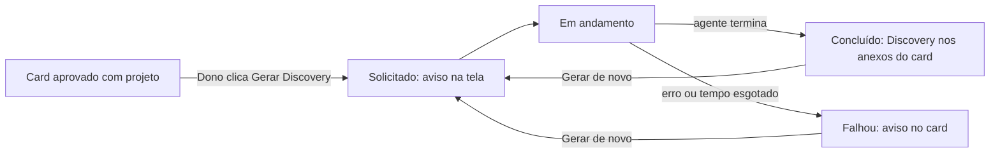

# Discovery: Disparo do Discovery por agente a partir do card aprovado

## 1. Resumo

Hoje o card gerado pela entrevista termina no status `approved` e não tem nenhum passo seguinte dentro do produto. A POC `scripts/poc_cursor_discovery.php` mostrou que é possível disparar um Cloud Agent do Cursor no repositório do projeto, passando o conteúdo do card e a skill de discovery (`resources/agent_skills/discovery/SKILL.md`), e receber de volta o documento de Discovery em Markdown, embasado no código real. A execução leva minutos, roda fora do produto e só funciona com um repositório definido.

A demanda leva esse fluxo para dentro do produto: num card aprovado, o dono do card dispara o Discovery por agente, o sistema avisa que a solicitação foi feita e, quando o agente termina, o Discovery passa a aparecer como anexo do card, legível dentro do próprio produto. O Cursor é o primeiro provedor de agente, mas o produto não pode ficar preso a ele.

## 2. Objetivo

Permitir que o dono de um card aprovado obtenha o documento de Discovery gerado por agente sobre o repositório do projeto, sem rodar script manualmente, e o leia anexado ao próprio card — mantendo a possibilidade de trocar o provedor de agente sem mudar a experiência do PM.

## 3. Escopo

### Dentro

- Ação "Gerar Discovery" disponível na tela do card somente para o dono do card, quando o card está aprovado e a conversa tem projeto (repositório) associado
- Disparo do agente no repositório e branch cadastrados no projeto do card, com o conteúdo do card como demanda
- Aviso ao PM, na tela do card, de que o Discovery foi solicitado e está em andamento
- Situação do Discovery visível no card: solicitado/em andamento, concluído ou falhou
- Ao concluir, o arquivo de Discovery fica salvo e aparece numa área de anexos do card
- Abrir o anexo mostra o Markdown renderizado dentro do produto, para leitura confortável
- Gerar de novo depois de concluído ou de falha; o novo Discovery substitui o anterior no anexo
- Em caso de falha ou tempo esgotado, o card mostra que o Discovery falhou
- Provedor de agente trocável: o Cursor é o primeiro, seguindo o mesmo padrão de contrato + adaptador já usado para LLM (ADR 0001–0007)

### Fora

- Responder às dúvidas levantadas no Discovery e regenerar com essas respostas — fica para um Discovery seguinte
- Anexos genéricos no card (upload de arquivo pelo PM ou outros tipos de anexo) — a área de anexos nasce só com o arquivo de Discovery
- Histórico de versões do Discovery — cada nova geração substitui a anterior
- Notificação fora da tela do card (e-mail, push, Slack) quando o agente termina
- Editar o Discovery dentro do produto
- Gravar o Discovery no repositório do projeto, abrir branch ou PR — o agente continua só lendo o código, como na POC
- Segundo provedor de agente além do Cursor
- Escolha do provedor ou do modelo do agente pelo PM ou pelo admin
- Registro de custo do agente nas métricas de uso de LLM
- Disparar Discovery a partir de card em rascunho, de card sem projeto ou por quem não é dono do card (inclusive admin)

## Fluxo

## 4. Premissas

- A primeira execução é a mesma da POC: Cloud Agent do Cursor via API, com a skill de discovery do catálogo injetada no pedido e o Markdown devolvido no resultado
- O provedor de agente segue o padrão do projeto de contrato + adaptador: trocar o Cursor por outro provedor não muda a ação no card, os estados nem o anexo
- O agente roda em modo somente leitura no repositório; o arquivo é salvo pelo PM Helper, não pelo agente
- O repositório e a branch vêm do projeto da conversa do card (cadastro do [Discovery 0002](0002-cadastro-projetos-github-mcp.md)); card sem projeto não pode disparar
- A chave da API do Cursor é única para o sistema e fica no ambiente (`CURSOR_API_KEY`), como na POC
- O PM não precisa ficar na tela esperando: a execução continua mesmo que ele saia, e o resultado aparece quando ele voltar ao card
- Só o dono do card dispara e vê o Discovery, no mesmo limite que já vale hoje para abrir e aprovar o card
- O produto guarda, em registro próprio ligado ao card (tabela própria, decisão do time), a situação do Discovery, qual provedor executou, a identificação da execução no provedor e a referência ao documento gerado; o anexo do card é encontrado por esse registro, nunca por caminho de arquivo
- Gerar de novo atualiza esse mesmo registro do card, sem criar outro
- Enquanto houver um Discovery em andamento para o card, não é possível disparar outro
- Gerar de novo substitui o Discovery anterior; se a nova geração falhar, o card mostra a falha (comportamento do anexo anterior nesse caso fica para o planejamento)

## 5. Considerações de segurança

- Dados sensíveis: `CURSOR_API_KEY` é credencial e deve ficar só no ambiente, nunca no banco nem exposta na tela. O conteúdo do card é enviado ao Cursor, e o agente lê o código do repositório do projeto (terceiro com acesso a código e à demanda)
- Autenticação/Autorização: disparar, ver a situação e abrir o anexo ficam restritos ao dono do card; o arquivo de Discovery não pode ter acesso público por URL direta
- Exposição de APIs: não há endpoint novo exposto fora do produto; o produto passa a chamar a API externa do Cursor
- Compliance: não aplicável além do envio de código e conteúdo do card ao Cursor, que precisa estar autorizado para os repositórios cadastrados
- Outras considerações: o agente deve continuar proibido de alterar o repositório (sem commit, push ou PR), como na POC. O Markdown vem de um agente externo e é exibido renderizado, então não pode executar HTML ou script embutido

## 6. Dúvidas

Nenhuma dúvida em aberto.

## 7. Informações ausentes

- Confirmação de que a conta Cursor ligada à `CURSOR_API_KEY` tem acesso a todos os repositórios cadastrados em projetos (na POC foram testados só `pm_helper` e `rapidtask`) — aceito como risco: sem acesso, o Discovery daquele projeto cai em falha

## 8. Status

**Pronto para Planejamento?** Sim

Quem dispara, o comportamento de gerar de novo, a leitura renderizada, o provedor trocável e o registro próprio do Discovery por card estão decididos; responder às dúvidas do Discovery ficou explicitamente para uma etapa seguinte.
