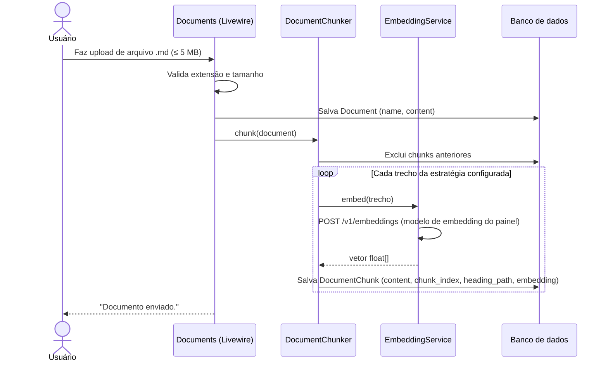
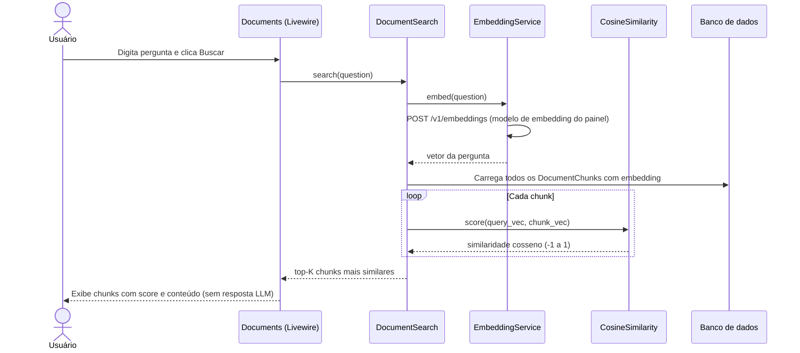
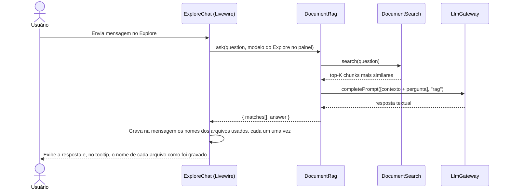
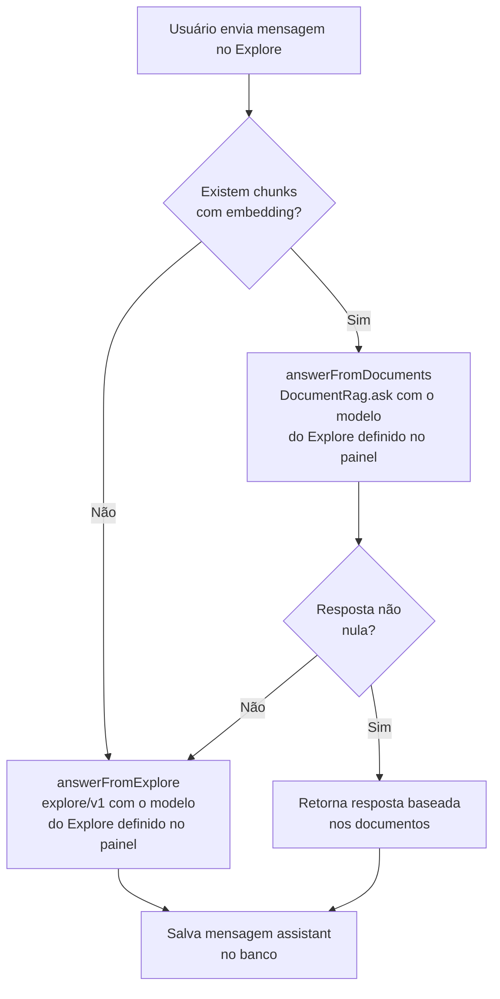
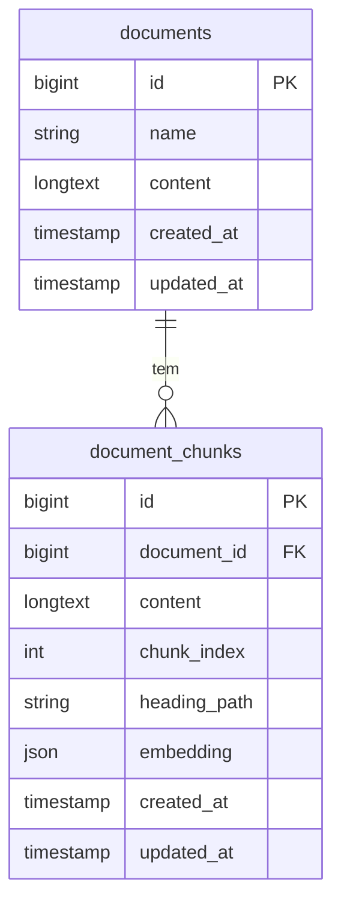

# RAG — Documentos como Contexto

> Retrieval-Augmented Generation: o usuário faz upload de arquivos `.md`, o sistema indexa o conteúdo com embeddings e usa os trechos mais relevantes como contexto para a LLM responder perguntas.

---

## Componentes

| Camada | Classe |
|---|---|
| Upload e orquestração | `Livewire\Documents` |
| Chunking + geração de embedding | `Services\DocumentChunker` |
| Geração de embedding (OpenAI) | `Services\EmbeddingService` |
| Busca por similaridade | `Services\DocumentSearch` |
| Cálculo de cosseno | `Services\CosineSimilarity` |
| Resposta com contexto (RAG) | `Services\DocumentRag` ← **somente no Explore** |
| Integração no chat Explore | `Livewire\ExploreChat` |
| Prompt do RAG | `resources/prompts/rag/v2.md` |

> **Separação de responsabilidades:** a tela **Documentos** só busca e exibe os chunks mais similares (sem LLM). A LLM é chamada exclusivamente pelo **ExploreChat**, que usa o `DocumentRag` para gerar uma resposta contextualizada.

**Banco de dados**

| Tabela | Propósito |
|---|---|
| `documents` | Nome e conteúdo bruto do arquivo |
| `document_chunks` | Trechos da estratégia configurada, com caminho de seções quando houver, + vetor de embedding (JSON) |

---

## Fluxo 1 — Ingestão de documento

---

## Fluxo 2 — Busca de chunks (tela Documentos)

> A tela Documentos **não chama a LLM**. Ela apenas recupera e exibe os chunks mais próximos por similaridade de cosseno — útil para inspecionar o índice e validar a qualidade dos embeddings. Trechos abaixo do score mínimo não entram. Se nenhum passar, a tela informa que não encontrou trechos.

---

## Fluxo 3 — RAG com resposta LLM (ExploreChat)

> O **ExploreChat** usa o `DocumentRag` para gerar uma resposta textual usando os chunks como contexto. A LLM **só é ativada aqui**.

A referência do tooltip é `documents.name`: no upload, o nome original do arquivo; na indexação do repositório, o caminho do arquivo. O tooltip não inclui trecho nem score. Resposta do fluxo padrão, sem documentos, não tem tooltip. O nome fica na mensagem e continua visível ao reabrir a exploração.

## Fluxo 4 — Prioridade RAG vs. Explore padrão

> **Prioridade:** se há documentos indexados, o Explore **sempre** tenta responder via RAG antes de usar o flow padrão de explore. Se nenhum trecho atingir o score mínimo, a resposta segue o fluxo padrão do Explore.

---

## Modelo de dados

---

## Parâmetros relevantes

| Parâmetro | Valor | Onde |
|---|---|---|
| Estratégia de corte | a definida no painel; até a primeira troca, por tamanho | `RagConfig` |
| Tamanho do chunk | o definido no painel; até a primeira troca, 500 caracteres. Nas estratégias por seção e por parágrafo, é o máximo do trecho | `RagConfig` |
| Modelo de embedding | o definido no painel, escolhido no catálogo; até a primeira troca, `text-embedding-3-small` | `RagConfig` |
| Top-K resultados | o definido no painel; até a primeira troca, 3 | `RagConfig` |
| Score mínimo | o definido no painel; até a primeira troca, 0 (sem filtro). Acima de 0, a busca descarta trechos com similaridade menor | `RagConfig` |
| Fontes de sincronização | checkboxes no painel (`README.md`, `docs/` na raiz, `docs/adr`, `docs/discovery`, `docs/references`, `docs/rules`); até a primeira troca, README + `docs` recursivo (comportamento anterior) | `RagConfig` → `ProjectDocumentsIndexer` |
| Origem do trecho | título, nome do arquivo e, quando houver, caminho de seções. Entra no texto embeddado e em `document_chunks.heading_path` | `DocumentChunker` |
| Modelo de resposta no Explore | o modelo do prompt `explore` no painel; até o admin salvar uma troca, `gpt-4o-mini` | `PromptModelConfig` (as duas saídas de resposta usam o mesmo valor) |
| Versão do prompt RAG | `v2` | `config/chat.php` → `prompts.rag` |

---

## Limitações atuais

- **Sem vector store:** a busca por similaridade carrega **todos** os chunks em memória — OK para volumes pequenos, inviável com muitos documentos.
- **Trocar estratégia, tamanho ou modelo de embedding não reindexa:** os trechos já gravados permanecem até o documento ser embeddado de novo. O painel avisa que a reindexação ficou pendente. O top-K e o score mínimo valem na busca seguinte.
- **Embedding requer `OPENAI_API_KEY`:** sem a chave, o upload falha no momento do chunking.
